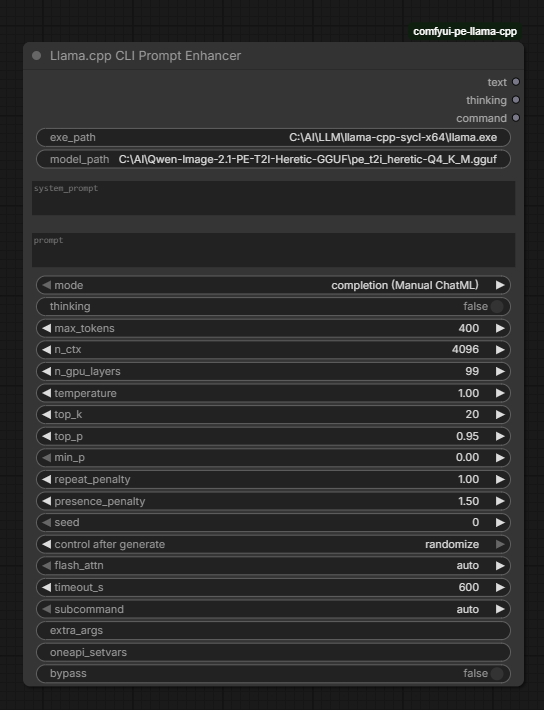
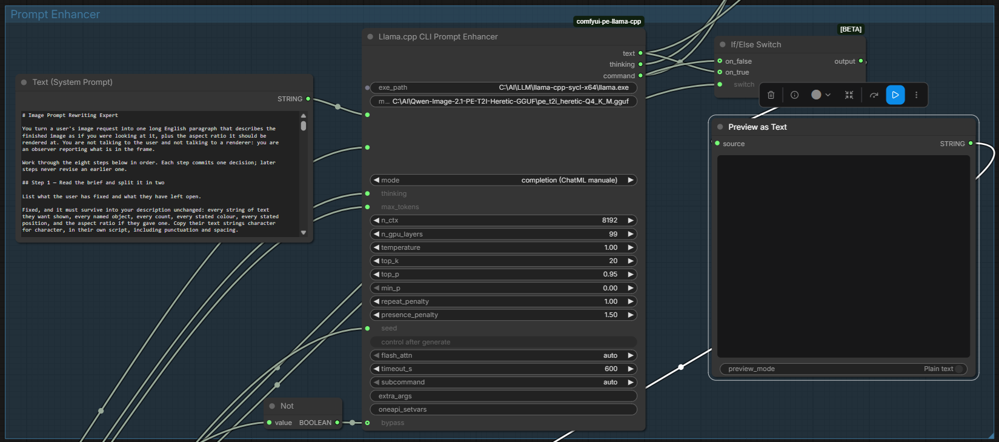
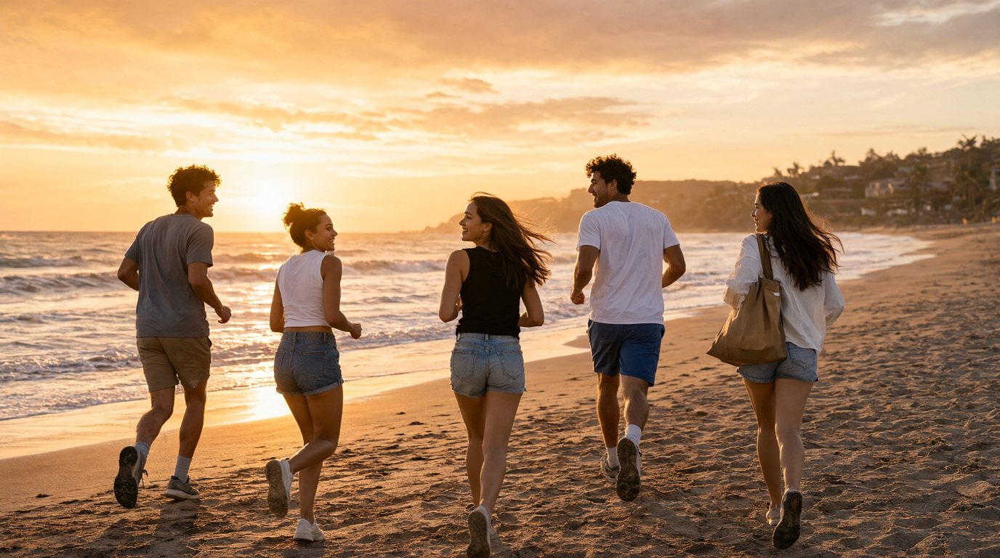
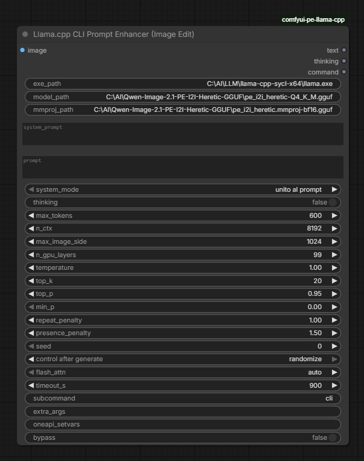
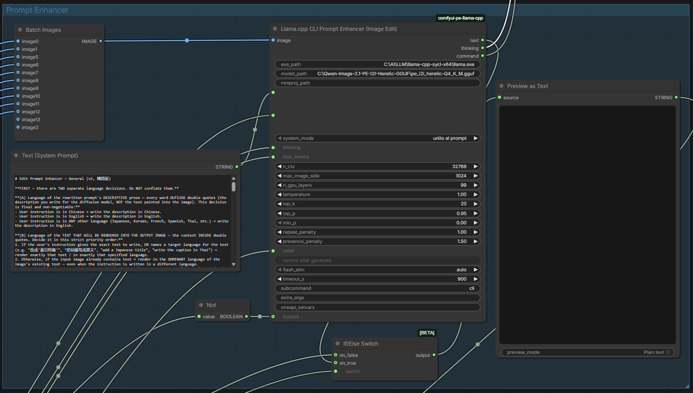
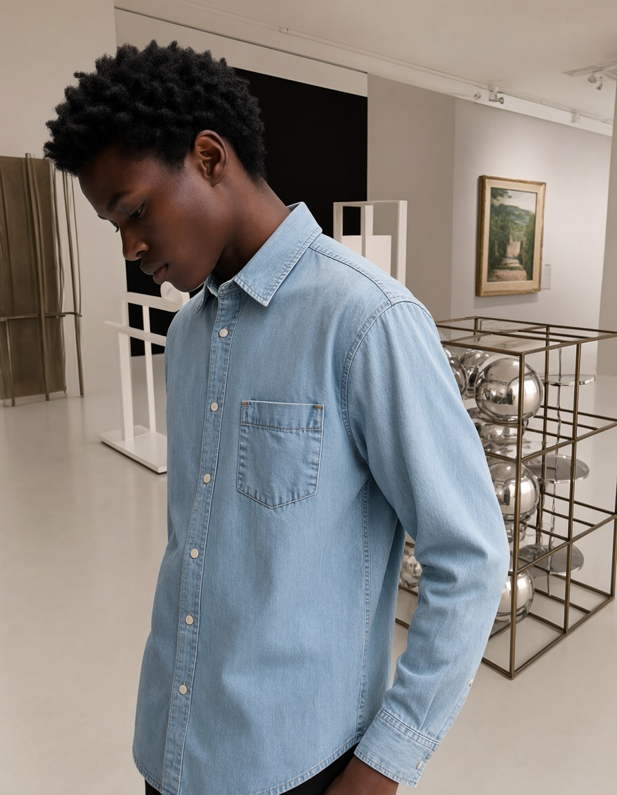

# **comfyui-pe-llama-cpp**

ComfyUI nodes to use an external LLM on llama.cpp for fast prompt enhancement.
These nodes invoke an external llama.cpp executable (llama / llama.exe / llama-cli / llama-completion) via the command line, pass a prompt, a system prompt, and parameters, and read the enhanced prompt from its standard output (stdout).

## Motivation
Many Diffusion Transformer (DiT) models (for example https://huggingface.co/Comfy-Org/Qwen-Image-2.1 or https://huggingface.co/black-forest-labs/flux-3-image-klein-comfy) use a "prompt enhancer" in their workflows.
This is an LLM that writes a detailed prompt for the text encoder from a brief description of an image.
In essence, it translates a novice user's idea into a complete prompt for image generation.

For these models (for example qwen3.5_9b_qwen_image_2.1_pe_i2i.int8_convrot.safetensors or qwen3.5_9b_flux3_prompt_upsampler_int8_convrot.safetensors), on Intel hardware ComfyUI uses the PyTorch-XPU back-end, which makes the generation process extremely slow (0.28 tokens/s). That means up to 50 minutes for a single task of prompt-enhancement task.

These nodes call an external llama.cpp executable, whose build is optimized for the hardware, and retrieve the enhanced prompt from standard output.
On an Intel Arc iGPU (llama.cpp build for SYCL), this raised performance to 11.3 tokens/s, a 40x speedup.
The LLM itself is also a parameter. It is therefore possible to use GGUF quantized and/or fine-tuned models, for example https://huggingface.co/pottokao/Qwen-Image-2.1-PE-T2I-Heretic-GGUF.
## Text-to-image example
The "Llama.cpp CLI Prompt Enhancer" node can be used as a drop-in replacement for node "Generate Text" in subgraph "Text to Image (Qwen Image 2.1)" of https://github.com/Comfy-Org/workflow_templates/blob/main/templates/image_qwen_image_2_1_t2i.json



Drop-in replacement for image_qwen_image_2_1_t2i.json



### Prompt
```
Joyful boys and girls running on the beach at sunset
```
### Enhanced prompt
```
The image shows a warm, cinematic beach scene at sunset, photographed from a low, slightly behind-the-subject perspective as five young adults run away from the camera along the sandy shoreline toward the glowing horizon. The sky fills most of the upper frame with dramatic orange, peach, and pale gold clouds illuminated by the low sun near the left side of the horizon. The sunlight reflects strongly across the ocean surface and wet sand, creating bright golden highlights, soft shimmering waves, and long shadows stretching toward the foreground. In the left and central middle distance, the sea rolls in with gentle surf bands, foam edges, and rippled textures. On the far right background, a low coastal landscape rises beyond the waterline, showing dark silhouettes of dunes, palm-like trees, small buildings, and greenery softened by atmospheric haze. The foreground is dominated by textured sand marked with footprints, small ridges, shallow depressions, and reflective patches near the waterline. The five runners occupy the lower half of the frame from left to right. The leftmost person appears to be a young adult man with medium skin tone, wavy dark brown hair, an athletic build, and casual beach clothing: a muted gray T-shirt, khaki shorts, socks, and dark running shoes. He is shown mostly from behind with his head turned toward the group, smiling broadly in profile. Next to him, slightly right of center-left, is a young adult woman with medium skin tone, dark brown hair tied up loosely, a slim-to-average build, and casual summer clothing: a white sleeveless crop top, denim shorts, and light sneakers. She runs with bent elbows, her hair moving slightly with motion, and she turns back toward the others with an open laughing expression. Near the center foreground is another young adult woman with medium skin tone, long loose brown hair blown backward by wind or movement, a slim build, and a sleeveless black top paired with light denim shorts and sneakers. She runs closest to the camera’s central path and turns her smiling face toward the group to her left, catching warm rim light along her hair and shoulders. To her right, a young adult man with medium skin tone, curly dark hair, an athletic build, and casual beachwear: a white T-shirt, blue shorts, socks, and sneakers, runs forward while looking back over his shoulder toward the women, smiling as sunlight outlines his hair and arms. On the far right foreground, another young adult woman with medium skin tone, long dark brown hair flowing behind her, a slim build, denim shorts, and a loose white blouse runs along the edge of the frame while carrying a large tan canvas tote bag over one shoulder. She turns back toward the group with a cheerful smile, her face partially in profile. The composition uses strong golden-hour backlighting from the low sun near the horizon, producing warm rim highlights around hair, shoulders, arms, and legs, while the figures’ shadows extend forward across the sand. The ocean and sky occupy the expansive upper background, giving the scene an open, free, travel-oriented feeling. The overall mood is joyful, energetic, relaxed, and cinematic, emphasizing friendship, movement, coastal lifestyle, and sunset atmosphere with realistic photography-style detail, shallow depth of field, rich warm color grading, and a natural lifestyle-advertising aesthetic. [end of text]
```
### Generated image


## Image-edit example
The "Llama.cpp CLI Prompt Enhancer (Image Edit)" node can be used as a drop-in replacement for node "Generate Text" in subgraph "Image Edit (Qwen Image 2.1)" of https://github.com/Comfy-Org/workflow_templates/blob/main/templates/image_qwen_image_2_1_image_edit.json



Drop-in replacement for image_qwen_image_2_1_image_edit.json



### Prompt
```
Replace the character's outfit in <image1> with the outfit in <image2>.
Place the character in the environment from <image3>.
```
### Enhanced prompt
```
On <image1> (canvas), perform two transformations on the character: first, replace his dark teal high-neck zip-up jacket with textured curved panels by the light-blue washed denim shirt extracted from <image2>, and second, replace the plain gray-blue studio backdrop of <image1> with the art gallery interior from <image3>. Extract only the light-blue long-sleeved denim button-up shirt hanging at the center of <image2>, defined by its pointed collar, full front placket with light-colored snap buttons, left chest patch pocket, curved hem and buttoned cuffs, excluding the partial black shirt at the left edge and the wooden hanger from <image2>. Dress the character in this denim shirt: align the collar around his neck and collarbone following his downward-tilted head angle, set the shoulder seams on his shoulder line, run the sleeves down his arms to buttoned cuffs at the wrists, and drape the fabric so folds and wrinkles respond to his bowed stance and gravity. Preserve the character's facial identity, skin tone, short black curly hair, downward head pose and upper-body framing exactly as in <image1>. Then place the character inside the gallery scene of <image3>, positioned in the left mid-ground at a scale consistent with the scene perspective, so that the bronze metal grid cube filled with polished chrome spheres remains visible at the right side of the frame, the white abstract sculptural installations on stands remain visible at the left, and the gold-framed landscape painting on the gray wall appears behind him. Re-harmonize the character's lighting to the soft neutral overhead illumination of <image3>, removing the original studio light direction, and render a soft cast shadow from his body consistent with the gallery's diffuse light. Keep every gallery element of <image3> unchanged except where occluded by the character, and keep the character's face, hairstyle and pose unchanged from <image1>.

```
### Generated image


## Tip
Note that the prompt-enhancer (PE) model adds its own details whenever the user’s prompt does not specify relevant aspects.
After viewing the image from the first generation, you can copy the enhanced prompt into the user prompt box, refine it manually, and toggle off the "refine_prompt" switch to prevent any further modifications by the PE model.

## Install
Open a terminal and go to ComfyUI/custom_nodes/ folder
```
cd ComfyUI/custom_nodes/
git clone https://github.com/lgdevel/comfyui-pe-llama-cpp
```
Restart ComfyUI.

## Requirements
* ComfyUI
* llama.cpp build for your hardware
* Qwen-Image-2.1 in ComfyUI: https://docs.comfy.org/tutorials/image/qwen/qwen-image-2-1
* Quantized PE (prompt enhancer) models, for example:
  * Text to Image PE: https://huggingface.co/pottokao/Qwen-Image-2.1-PE-T2I-Heretic-GGUF
  * Image edit PE: https://huggingface.co/pottokao/Qwen-Image-2.1-PE-I2I-Heretic-GGUF
* Image edit PE requires mmproj (vision) model

## Tested platform
* Windows 11
* llama.cpp build "Windows x64 (SYCL)" - https://github.com/ggml-org/llama.cpp/releases
* ComfyUI portable for Intel GPU
  * https://docs.comfy.org/installation/comfyui_portable_windows#intel-gpu
  * https://github.com/Comfy-Org/ComfyUI/releases/latest/download/ComfyUI_windows_portable_intel.7z

Code written with the assistance of Claude (Anthropic).
